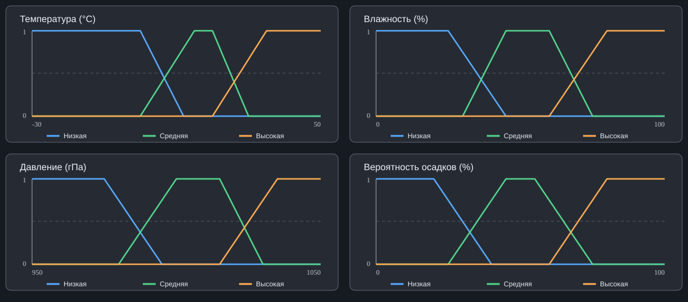

# Лабораторная работа №4: нечёткий вывод Мамдани

**Дисциплина:** Искусственный интеллект  
**Вариант №1:** Прогнозирование погодных условий  
**Студент:** Пармакли Леонид, IA2404ru  
**Преподаватель лабораторных работ:** Елизавета Третьякова
**Преподаватель курса:** Виктория Требиш
**Дата подготовки отчёта:** 10.11.2026

## 1. Цель работы

Разработать интерактивную нечёткую систему для оценки вероятности осадков по температуре, влажности и атмосферному давлению. Реализовать фаззификацию, правила IF–THEN, импликацию и агрегацию Мамдани, дефаззификацию методом центроида и графическое отображение результатов.

Исходные требования и формулировка варианта приведены в [AILab4.md](AILab4.md).

## 2. Технологии

| Элемент | Использованное средство |
|---|---|
| Язык программирования | C++ |
| Сборка | CMake, Visual Studio 2019 (MSVC16) |
| Движок | Krystallic Engine |
| Математическая модель | Собственная реализация алгоритма Мамдани на C++ |
| Платформа | Windows |

Программа является **отдельным приложением**, а не подсистемой Krystallic Engine. Библиотеки движка предоставляют исключительно платформенную и графическую инфраструктуру.

## 3. Переменные нечёткой системы

| Переменная | Направление | Диапазон | Термы |
|---|---|---|---|
| Температура воздуха | Входная | −30…50 °C | Низкая, умеренная, высокая |
| Влажность | Входная | 0…100% | Низкая, средняя, высокая |
| Давление | Входная | 950…1050 гПа | Низкое, среднее, высокое |
| Вероятность осадков | Выходная | 0…100% | Низкая, средняя, высокая |

Для всех переменных применяются трапециевидные функции принадлежности, включая плечевые функции по краям области определения. Каждое множество описывается параметрами **(a, b, c, d)**; на [b, c] принадлежность равна 1, за пределами [a, d] — 0, на боковых участках меняется линейно.

### 3.1. Параметры функций принадлежности

| Переменная | Низкая | Средняя | Высокая |
|---|---|---|---|
| Температура, °C | (−30, −30, 0, 12) | (0, 15, 20, 30) | (20, 35, 50, 50) |
| Влажность, % | (0, 0, 25, 45) | (30, 45, 60, 75) | (60, 80, 100, 100) |
| Давление, гПа | (950, 950, 975, 995) | (980, 1000, 1015, 1030) | (1015, 1035, 1050, 1050) |
| Осадки, % | (0, 0, 20, 40) | (25, 45, 55, 75) | (60, 80, 100, 100) |

*Рисунок 1 — Аналитические графики, построенные по параметрам из FuzzySystem.cpp. В интерфейсе приложения графики дополнительно показывают маркеры текущих значений, агрегированное выходное множество и центроид.*

## 4. База правил IF–THEN

В соответствии с вариантом реализованы **девять правил**:

| Правило | Условие (IF) | Результат (THEN) |
|---|---|---|
| R1 | Температура низкая **И** влажность высокая | Вероятность высокая |
| R2 | Температура умеренная **И** влажность высокая | Вероятность высокая |
| R3 | Температура высокая **И** давление высокое | Вероятность низкая |
| R4 | Температура высокая **И** влажность низкая | Вероятность низкая |
| R5 | Давление низкое **И** влажность высокая | Вероятность высокая |
| R6 | Давление среднее **И** влажность средняя | Вероятность средняя |
| R7 | Температура низкая **И** давление низкое | Вероятность высокая |
| R8 | Температура умеренная **И** давление высокое | Вероятность низкая |
| R9 | Температура высокая **И** влажность средняя | Вероятность средняя |

Оператор AND реализован через минимум, OR — через максимум. **Девять правил данного варианта используют AND**; механизм OR присутствует в коде, но отдельное правило с OR в испытанную базу не входит.

## 5. Алгоритм Мамдани

### 5.1. Фаззификация

Числовые значения температуры, влажности и давления преобразуются в степени принадлежности множествам Low, Medium, High. Одно число может одновременно иметь ненулевую принадлежность нескольким множествам.

### 5.2. Активация правил

Для двух условий, связанных оператором AND:

\[
\alpha_i = \min(\mu_{A_i}(x_1), \mu_{B_i}(x_2)).
\]

Для OR реализована операция \(\max\) над соответствующими степенями. Активным считается правило с \(\alpha_i>0\); полученные значения сохраняются в массиве ruleActivation.

### 5.3. Импликация и агрегация

Каждая выходная функция усекается до уровня активации правила:

\[
\mu_i^{clip}(y) = \min(\alpha_i, \mu_{C_i}(y)).
\]

Результаты всех правил объединяются через максимум:

\[
\mu_{agg}(y) = \max_i \mu_i^{clip}(y).
\]

Для одинаковых заключений сначала используется максимальная активация соответствующего выходного терма, что эквивалентно агрегации всех правил с этим заключением.

### 5.4. Дефаззификация

Числовая вероятность находится по центроиду агрегированного множества:

\[
y^* = \frac{\int_{0}^{100} y\,\mu_{agg}(y)\,dy}{\int_{0}^{100}\mu_{agg}(y)\,dy}.
\]

В программе интегрирование выполнено численно методом трапеций: диапазон **0–100%**, шаг **0,25**, половинные веса у первого и последнего узлов. Категория определяется по наибольшей степени принадлежности выходных термов в точке центроида.

Если правила не активировались или площадь агрегированного множества равна нулю, программа возвращает состояние **NoActiveRules**; такое состояние **не означает вероятность 0%**.

## 6. Архитектура и исходные файлы

~~~text
src_lab4/
├── SBoxData/                     # Шрифты и прочие ресурсы
└── src/
    ├── main.cpp
    ├── CMakeLists.txt
    ├── app/
    │   ├── Lab4App.h
    │   └── Lab4App.cpp
    ├── fuzzy/
    │   ├── FuzzyTypes.h
    │   ├── FuzzySystem.h
    │   └── FuzzySystem.cpp
    ├── weather/
    │   ├── WeatherTypes.h
    │   ├── WeatherModel.h
    │   └── WeatherModel.cpp
    ├── ui/
    │   ├── Lab4UI.h
    │   ├── Lab4UI.cpp
    │   ├── MembershipGraph.h
    │   └── MembershipGraph.cpp
    └── render/
        ├── GUIRHI.h
        ├── GUIRHIFrame.cpp
        └── GUIRHIRender.cpp
~~~

| Компонент | Назначение |
|---|---|
| **CLab4App** | Инициализация и жизненный цикл; обработка событий, кадров и запросов расчёта |
| **CFuzzySystem** | Множества, правила, активация, агрегация, центроид |
| **CWeatherModel** | Предметная модель погоды и доступ к системе вывода |
| **CLab4UI** | Слайдеры, кнопка, авторасчёт, результаты, диагностическая панель |
| **CMembershipGraphSystem** | Пользовательский GUI-контрол, зарегистрированный через IGUIControlSystem (тип 32), отображение четырёх графиков |
| **CGUIRHIFrame / CGUIRHIStrategy** | Рендер GUI через RHI и SwapChain |

GUI и рендер обновляются каждый кадр. Вычисления Мамдани выполняются **по запросу** либо при изменении слайдеров с включённым «Авторасчётом».

## 7. Пользовательский интерфейс

Приложение предоставляет:
- три слайдера для ввода температуры, влажности и давления;
- кнопку **«Рассчитать»** и режим **«Авторасчёт»**;
- численную вероятность, текстовую категорию и количество активных правил;
- четыре графика функций принадлежности;
- заполнение агрегированной выходной функции и линию центроида;
- диагностическую панель по клавише **F1**, показывающую девять правил и их степени активации. Повторное нажатие возвращает графики.

Предусмотрены состояния **Success**, **InvalidInput**, **NoActiveRules**, а также сообщение о том, что параметры изменены и нужно повторить расчёт. Слайдеры ограничивают допустимый диапазон, а модель дополнительно проверяет диапазоны и конечность входных значений.

## 8. Тестирование

Испытания выполнены **вручную, в сборке Windows Win32 Debug**. Зафиксированы семь сценариев (скриншоты сделаны 09.11.2026).

### 8.1. Тест №1: низкая, средняя и высокая вероятность

Цель: убедиться, что алгоритм формирует все три категории прогноза и корректно определяет количество активных правил.

**Таблица 1 — Входные тестовые значения**

| Сценарий | Температура, °C | Влажность, % | Давление, гПа |
|---|---:|---:|---:|
| 1.1 — Низкая вероятность | 40,0 | 15,0 | 1040,0 |
| 1.2 — Средняя вероятность | 40,0 | 50,0 | 1000,0 |
| 1.3 — Высокая вероятность | −10,0 | 90,0 | 960,0 |

**Таблица 2 — Сопоставление ожидаемых и полученных результатов**

| Сценарий | Ожидаемая вероятность | Получено в программе | Ожидаемые активные правила | Получено активных правил | Итог |
|---|---|---|---|---:|---|
| 1.1 | 15,6% (низкая) | **15,6% (низкая)** | R3, R4 | **2** | Совпадает |
| 1.2 | 50,0% (средняя) | **50,0% (средняя)** | R6, R9 | **2** | Совпадает |
| 1.3 | 84,4% (высокая) | **84,4% (высокая)** | R1, R5, R7 | **3** | Совпадает |

Результаты сняты с трёх экранов приложения. Для каждого случая на выходном графике отображалась соответствующая агрегированная функция принадлежности и маркер центроида.

### 8.2. Тест №2: одновременная активация разных выходных множеств

Цель: проверить совместную работу нескольких правил с различными заключениями и агрегацию их выходных функций.

**Таблица 3 — Входные значения смешанного сценария**

| Температура, °C | Влажность, % | Давление, гПа |
|---:|---:|---:|
| **20,0** | **69,5** | **1020,0** |

Примечание: в фактическом тесте установлена влажность **69,5%**, а не 70,0%. Поэтому расчётный результат отличается от предварительного примера с влажностью 70%.

**Таблица 4 — Ожидаемые степени активации всех девяти правил**

| Правило | Выходное множество | Степень активации |
|---|---|---:|
| R1 | Высокая | 0,000 |
| R2 | Высокая | **0,475** |
| R3 | Низкая | 0,000 |
| R4 | Низкая | 0,000 |
| R5 | Высокая | 0,000 |
| R6 | Средняя | **≈0,367** |
| R7 | Высокая | 0,000 |
| R8 | Низкая | **0,250** |
| R9 | Средняя | 0,000 |

**Таблица 5 — Итог вычисления**

| Показатель | Ожидалось по модели | Получено в программе |
|---|---|---|
| Вероятность осадков | ≈56,6% | **56,6%** |
| Категория | Средняя | **Средняя** |
| Число активных правил | 3 | **3** |
| Активные правила | R2, R6, R8 | **3 активных правила**, что подтверждено числом в GUI; их степени приведены выше как расчётные |

На скриншоте выходного графика видно объединение усечённых областей трёх разных множеств и смещение центроида вправо от 50%. Это показывает, что система использует агрегацию, а не выбирает только одно правило.

### 8.3. Тест №3: крайние значения и отсутствие активных правил

Цель: проверить границы диапазонов функций принадлежности и случай, когда дефаззификация невозможна.

**Таблица 6 — Входные тестовые значения**

| Сценарий | Температура, °C | Влажность, % | Давление, гПа |
|---|---:|---:|---:|
| 3.1 — Все параметры минимальные | −30,0 | 0,0 | 950,0 |
| 3.2 — Все параметры максимальные | 50,0 | 100,0 | 1050,0 |
| 3.3 — Нет активных правил | −10,0 | 10,0 | 1040,0 |

**Таблица 7 — Сопоставление ожидаемых и полученных результатов**

| Сценарий | Ожидаемый результат | Наблюдавшийся результат | Активные правила | Итог |
|---|---|---|---|---|
| 3.1 | 84,4% (высокая) | **84,4% (высокая)** | R7 — 1 | Совпадает |
| 3.2 | 15,6% (низкая) | **15,6% (низкая)** | R3 — 1 | Совпадает |
| 3.3 | Вероятность не определена, `NoActiveRules` | На исходном скриншоте отображались `?`; числовой результат отсутствовал | 0 | Математический результат соответствует ожиданию, индикация исправлена позднее |

Для сценария **3.3** ни одно правило не активируется, поэтому агрегированное выходное множество имеет нулевую площадь и числовая вероятность не вычисляется. Первоначальный интерфейс при этом показывал символы `?` и сообщение о необходимости расчёта. **После тестирования код интерфейса исправлен**, чтобы отображать «Нет активных правил. Вероятность не определена». Повторный скриншот после этого исправления не предоставлялся.

### 8.4. Проверка интерфейса

Подтверждена работа изменения входных значений, отображения графиков и их центроидов, повторного расчёта без перезапуска. После исправления обработки клавиатуры пользователь подтвердил успешное переключение диагностики по **F1**.

Отдельный автоматический тест с программной передачей некорректных значений и тест отдельного правила OR **не проводились**. Эти случаи не следует считать испытанными только на основании наличия их обработки в коде.

## 9. Анализ результатов

Низкая, средняя и высокая вероятность возвращают ожидаемые значения и соответствующие графические интерпретации. Смешанный сценарий подтверждает, что несколько правил могут одновременно активировать **разные** выходные множества; результат формируется агрегированием, а не выбором одного правила. Граничные сценарии подтверждают корректную обработку плечевых функций. При отсутствии активных правил числовой прогноз не формируется.

Это **учебная экспертная модель**: значения границ множеств и база правил заданы вручную. Результат не следует интерпретировать как статистически откалиброванный реальный прогноз погоды.

## 10. Сборка и запуск

Клонирование ветки лабораторной:

~~~bat
git clone --single-branch -b Lab4 https://github.com/leopard-bf187/AI_labworks.git
cd AI_labworks
~~~

Сборка Win32 Debug (использована для тестирования):

~~~bat
build_engine_msvc16_win32d.bat
~~~

Для всех конфигураций Visual Studio 2019:

~~~bat
__build_engine_msvc16.bat
~~~

Предусмотрены Win32, Win64, WinArm64 в конфигурациях Debug, Checked и Release. CMake использует готовые библиотеки движка Krystallic из папки **build/**, выходные каталоги **__build/** и каталог установки **__install/**. Ресурсы из **src_lab4/SBoxData/** копируются к приложению вместе с DLL.

## 11. Вывод

В лабораторной работе создано самостоятельное интерактивное C++-приложение, реализующее нечёткую систему Мамдани для оценки вероятности осадков по трём входным показателям. Реализованы девять правил IF–THEN, функции принадлежности, численное вычисление центроида, графики и диагностическая панель.

Проведены семь практических сценариев: три категории прогноза, смешанная активация, оба крайних случая и отсутствие активных правил. Результаты согласуются с математической моделью. Выявленная проблема текстовой индикации NoActiveRules была исправлена после тестирования; дополнительные проверки этого исправления и сценариев OR/некорректного прямого ввода можно выполнить отдельно.
